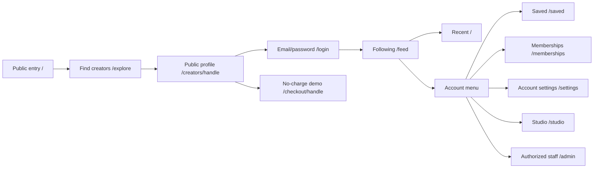

# KAR-143 — Navigation and workspace contract

**Status:** proposed for the KAR-130 review gate, November 7, 2026. Source baseline: `7c8feadd09c7dcf470de510c630d4ad44e9dd92c`. The owner accepted [direction PR #7](https://github.com/KardanDev/privana/pull/7) and [identity PR #8](https://github.com/KardanDev/privana/pull/8), then authorized this group. No runtime route, permission or navigation component changes here.

## Design decision

Retain the existing URLs and separate **community**, **Studio** and **platform operations**. Use the approved Proximidade visual language around familiar controls. A creator remains a fan; opening Studio changes the task context, not the account. Staff enter a separate operations shell and can return to the community without changing their role.

Keep the current distinction between recent and following feeds: `/` is **Recentes** for signed-in users, `/feed` is **Seguindo**. The default login destination remains `/feed` until the existing return-path gap is repaired. Anonymous `/` becomes a truthful public introduction with creator discovery/public content; `/explore` remains the dedicated search destination. No paid entitlement, identity assurance or new feature is implied by the home presentation.

The diagram is a task map, not an authorization grant. [The role matrix](role-matrix.md) owns access distinctions; the server remains authoritative. No new page is created for “Account menu”, Studio tabs or operations sections.

## Responsive examples

| Context | Desktop / roomy tablet | Phone / narrow viewport |
| --- | --- | --- |
| Anonymous | Brand, Explorar, Entrar; Criar conta only when registration is enabled. Public creator content leads. | Brand and entry actions; no authenticated tab bar, account avatar or misleading publication shortcut. |
| Fan | Left rail: Início, Explorar, Mensagens, Salvos, Assinaturas. Account group: Configurações; Quero publicar only when application entry is available. | Four bottom destinations: Início, Explorar, Mensagens, Conta. Conta exposes Salvos and Assinaturas directly, plus Configurações, theme, sign-out and eligible workspace entry. |
| Active creator profile | Fan rail plus Meu Studio and a publication shortcut that enters the existing Studio editor flow. | Five bottom destinations: Início, Explorar, Studio, Mensagens, Conta. Studio publication action stays prominent near its heading. |
| Applicant/pending/restricted profile | Retain community use when the account is active. Studio entry uses a truthful status label; no enabled publication shortcut from mere profile existence. | The fan tab bar stays stable; Minha candidatura/Meu Studio lives in Conta. Studio itself explains pending/restricted state and available recovery. |
| Staff | Separate `/admin` rail containing only allowed sections; explicit Voltar à comunidade. Community rail remains available only after leaving operations. | Operations header plus one section menu/drawer and Voltar à comunidade. Do not stack the community bottom bar underneath the owner shell. |

At intermediate widths use a labeled drawer or compact rail only when its tasks remain discoverable. Never hide Salvos/Assinaturas behind an unlabeled overflow icon. At phone size they are one menu opening plus one selection from any fan screen. Removing disabled Mensagens redistributes available tab space; direct old links retain an honest unavailable state.

## Labels and entry rules

- **Conta** names the phone account-menu trigger. **Configurações** names `/settings`. Remove the misleading current “Perfil” tab pointing to account settings.
- **Ver perfil público** links to `/creators/[handle]` only when a real handle and public availability are known. Viewer data returns profile ID/status but no handle; do not invent a slug from the account name. Studio's loaded profile supplies the handle.
- **Quero publicar** enters `/studio` application/profile flow when allowed. **Minha candidatura** is for an existing application; **Meu Studio** is the workspace label. **Nova publicação** requires an ACTIVE publishing profile, not only `creatorId` or a role string.
- The account and creator profile can have different status. An active account with a restricted creator profile can retain fan actions; a suspended account does not gain member access from an old client session.
- Published CMS labels override supported navigation wording; this proposal describes default labels. Do not add routes or staff capabilities through label customization.

## Existing URLs and local state

Preserve all 21 page entries in [the route matrix](role-matrix.md), including `/dashboard` → `/studio`, `/checkout` → `/checkout/demo`, and `/success` → `/memberships`. Keep creator handles, current query strings and safe return paths intact. Unknown/private targets receive the existing server result; do not redirect users into a more privileged workspace.

`/admin` sections currently use React state, not shareable section URLs. Studio tabs/editor and filters are also local state. Do not advertise invented `/admin/cms`, `/studio/posts`, `?section=` or `?compose=` deep links. A later shell implementation can improve same-route history intentionally, but must retain current route compatibility and document any new URL contract before adoption.

## Source reconciliation and walkthrough

Source: [fan navigation](../../../apps/web/src/shared/layout/navigation.ts), [phone navigation](../../../apps/web/src/shared/layout/mobile-navigation.tsx), [account menu](../../../apps/web/src/shared/layout/mobile-account-menu.tsx), [shell](../../../apps/web/src/shared/layout/app-shell.tsx), [viewer](../../../packages/api/src/domains/viewer/get.ts), [owner sections](../../../apps/web/src/domains/admin/operations-navigation.ts), [local owner navigation](../../../apps/web/src/domains/admin/use-operations-navigation.ts), [Studio state](../../../apps/web/src/domains/studio/use-studio-screen.ts).

| Walked task / current discrepancy | Proposed outcome / later implementation owner |
| --- | --- |
| Phone “Perfil” opens settings; saved/membership entries exist only in account menu | Explicit Conta trigger and Configurações label; predictable menu entries. KAR-148/159. |
| Creator-ID shortcut can imply publication while the profile is pending | Derive publication affordance from the returned creator status; Studio/server recheck. KAR-148/161–163. |
| Public/fan header and search patterns differ between contexts | One relevant search and a clear public-versus-signed-in home. KAR-148/151/154–155. |
| Login receives a return hint but always routes successful login to `/feed` | Preserve current fallback; prototype the intended safe-return repair with an explicit gap annotation. KAR-152/M02 must validate before rollout. |
| Staff navigation is already role-filtered; sections are not deep-link routes | Retain the eight-section permission model and same-route state. KAR-148/164–168. |

This is a source/task walkthrough, not a fresh authenticated production-browser test. [Interaction rules](interactions.md) define search, history, focus and interrupted work. [The prototype plan](prototype-plan.md) assigns concrete review evidence. G1 approval remains KAR-145; no KAR-131 implementation starts from this proposal alone.
